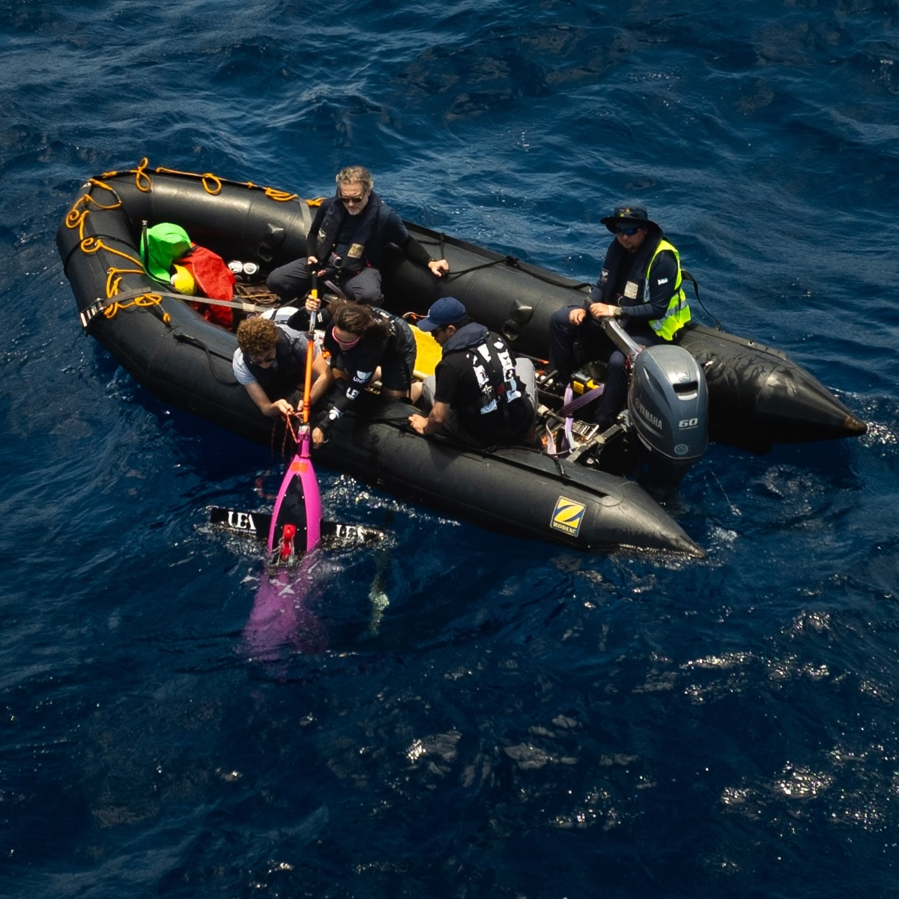

# Nicolaos Petropoulos

I am a researcher working at the intersection of applied mathematics and geophysical fluid mechanics. I use a hierarchy of methods—theory, idealised laboratory experiments, direct numerical simulations, in-situ observations—and tools from dynamical system theory, stochastic processes, statistical mechanics, and machine learning to develop predictive surrogate models for chaotic, turbulent, and geophysical fluid flows.

My current work focuses on transport, dispersion and mixing in the stratified ocean. These processes have a major impact on phenomena like large-scale ocean circulation and biological productivity. They are also key to understanding carbon dioxide, pollutants, and microplastics pathways. 

I have a strong background in developing numerical models of complex physical systems, ranging from fluids to control systems for autonomous sailing boats. I worked in the design team of the successful America's Cup team [Emirates Team New Zealand](https://emirates-team-new-zealand.americascup.com/), optimizing control systems. Recently, I have been designing a regional model of the equatorial Atlantic Ocean, including both dynamical and biogeochemical processes. This is part of an ongoing effort to better understand deep ocean life in the [Romanche Fracture Zone](https://schmidtocean.org/cruise/life-at-the-romanche-fracture-zone/). 

**[CV](CV_Nicolaos_Petropoulos_2026.pdf)**
